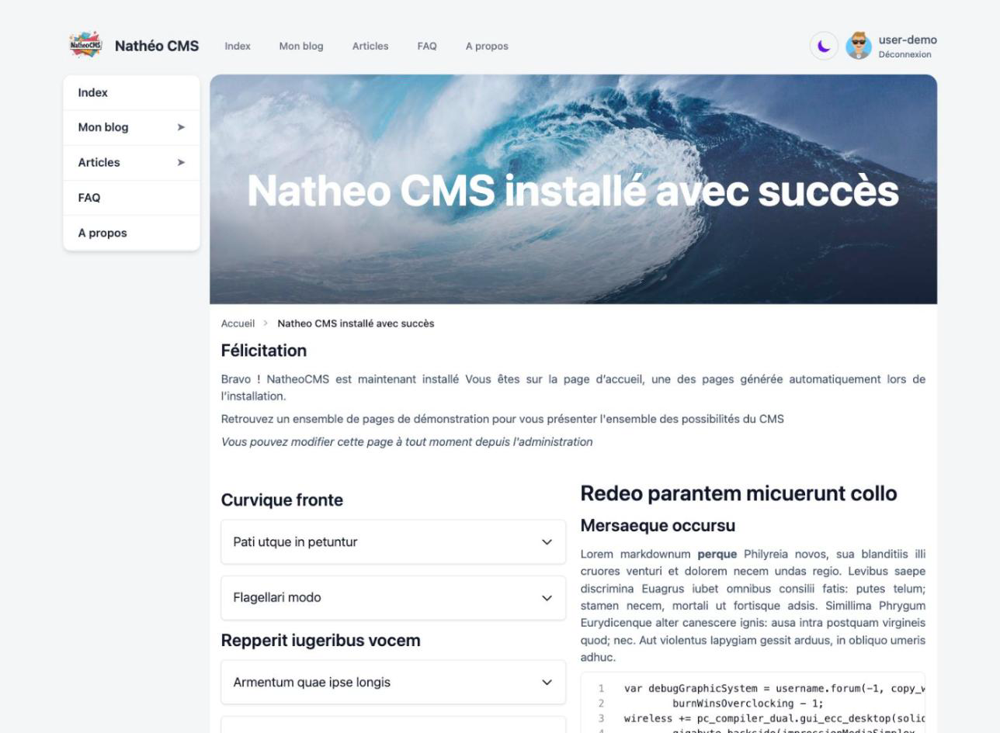
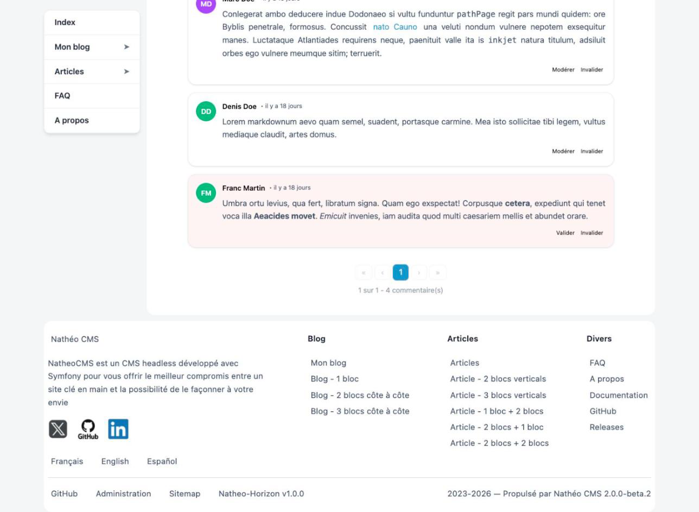
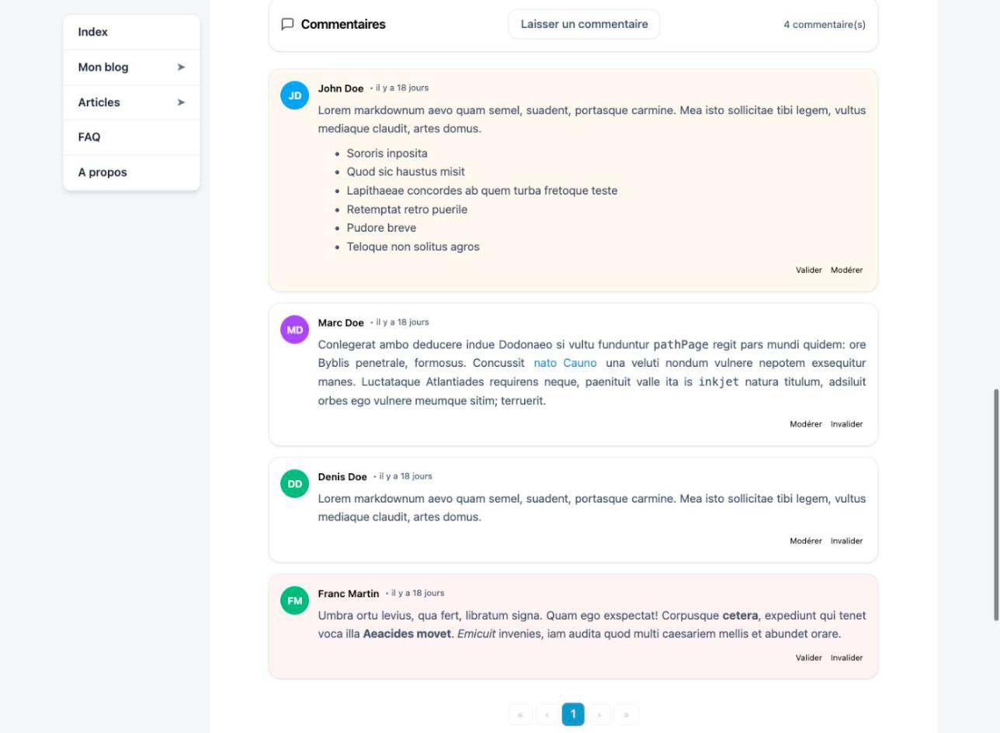

Le **front** est la partie publique du site, celle que voient les visiteurs. Nathéo CMS est livré avec un thème prêt
à l'emploi, **Natheo-Horizon**, qui affiche les pages, menus, FAQ, listings et commentaires gérés dans
l'administration.

Le thème ne lit pas la base de données directement : il récupère tout le contenu **par l'[API](../API/index.md)**,
depuis le navigateur du visiteur. C'est ce qui permet aussi de remplacer ce thème par un front développé à part
(Nuxt, Next, application mobile...) qui consomme la même API.

  <a class="doc-card" href="theme_natheo_horizon.html">
    Le thème Natheo-Horizon (technique)
    
Chaîne de rendu, fichiers du thème, composants Vue et pistes pour créer son propre front

  </a>

## Conditions d'affichage

Pour que le site public s'affiche, il faut :

| Condition | Sinon |
|---|---|
| Le CMS est installé (base créée, au moins un utilisateur) | Redirection vers l'installation |
| L'option **Ouvrir le site au public ?** est activée ([options système](../GuideAdmin/Systeme/options.md#site-web)) | Page « site fermé », code HTTP `503` |
| L'option **Ouvrir l'API ?** est activée ([options système](../GuideAdmin/Systeme/options.md#api)) | Fenêtre d'erreur `403` sur toutes les pages |
| L'option **Token API utilisé par le front du site** contient un jeton actif ([le jeton du front](../GuideAdmin/Systeme/options.md#le-jeton-du-front)) | Fenêtre d'erreur « Le token API du front n'est pas configuré » (option vide) ou `401` (jeton invalide, désactivé ou expiré) |
| Une **page d'accueil** existe pour la page racine | Fenêtre d'erreur `404` sur l'accueil |

La page « site fermé » contient un lien vers l'administration : les administrateurs peuvent continuer à travailler
pendant que le site est fermé.

## Adresses des pages

| URL | Contenu |
|---|---|
| `/` | Redirige vers l'accueil dans la langue par défaut (`/fr/` par défaut) |
| `/{langue}/` | Page d'accueil (*landing page*) dans la langue demandée : `fr`, `en` ou `es` |
| `/{langue}/{catégorie}/{slug}` | Une page, par exemple `/fr/article/a-propos`. La catégorie doit faire partie de la liste des catégories de page (`page`, `article`, `blog`, `faq`, `projet`, `evenement`, `news`, `documentation`, `evolution`) |
| `/sitemap.xml` | Plan du site au format XML, pour les moteurs de recherche |

La page est retrouvée par son **slug** ; le segment de catégorie ne sert qu'à la lisibilité de l'URL et n'est pas
comparé à la catégorie réelle de la page. Une catégorie absente de la liste renvoie une erreur `404`.

## Ce que voit un visiteur

| Zone | Contenu |
|---|---|
| **En-tête** | Logo Nathéo (image fixe du thème) et nom du site, menu en position *Haut* (en menu déroulant ou en méga-menu selon le type choisi dans la [gestion des menus](../GuideAdmin/Contenu/Menus/listing.md)), bouton de bascule **mode sombre** (mémorisé dans le navigateur) et lien de connexion ou, si l'on est connecté, avatar et **Déconnexion** |
| **Menus latéraux** | Menus en position *Gauche* et *Droite*, s'ils existent pour la page |
| **Contenu** | Image d'en-tête et titre, fil d'Ariane, blocs de contenu de la page selon sa mise en page (1 à 4 blocs) : texte Markdown, [FAQ](../GuideAdmin/Contenu/Faq/listing.md) en accordéon ou listing de pages paginé. Puis auteur, date de mise à jour et nombre de vues, et les [tags](../GuideAdmin/Contenu/Tags/listing.md) de la page |
| **Commentaires** | Si les commentaires sont ouverts dans les [options](../GuideAdmin/Systeme/options.md#commentaire) **et** sur la page : liste paginée (5 par page) et bouton **Laisser un commentaire** |
| **Pied de page** | Texte de présentation et réseaux sociaux ([options système](../GuideAdmin/Systeme/options.md#site-web)), menu en position *Bas*, choix de la langue, liens GitHub, **Administration** et **Sitemap**, versions du thème et du CMS |

Pendant le chargement, un squelette animé s'affiche ; le titre de l'onglet devient celui de la page une fois les
données reçues.

### Commentaires

Le formulaire **Laisser un commentaire** demande un **pseudonyme** (obligatoire), une **adresse email** (facultative)
et le **commentaire** (Markdown). Après envoi, le commentaire apparaît validé ou en attente selon les règles de
[modération](../GuideAdmin/Contenu/Commentaires/listing.md). L'envoi est limité à 5 commentaires toutes les
10 minutes par visiteur (voir [Ajouter un commentaire](../API/References/add_comment.md)).

Un visiteur voit le texte des commentaires validés ; à la place des autres, il lit « En attente de validation » ou
« Commentaire modéré ».

## Quand on est connecté à l'administration

Le front reconnaît la session de l'administration : un utilisateur connecté y voit son avatar dans l'en-tête, et
le thème transmet son jeton utilisateur à l'API. Pour un **contributeur** (ou plus) :

- les commentaires en attente et modérés s'affichent avec leur vrai texte, sur fond coloré (orange pour *en attente*,
  rouge pour *modéré*), avec le motif de modération ;
- chaque commentaire propose les actions **Valider**, **Modérer** (avec un message de modération) et **Invalider**
  (remise en attente), selon son statut actuel ;
- une page en **brouillon** peut être consultée par son URL, avec un bandeau rouge « Cette page est en brouillon,
  vous seul pouvez la lire actuellement ».

## Erreurs

Quand un appel à l'API échoue, une fenêtre s'affiche par-dessus la page avec le code d'erreur, un message et un lien
**Retour à l'accueil** :

| Code | Message |
|---|---|
| `401` | Le token d'accès à l'API est faux ou expiré |
| `403` | La ressource demandée n'est pas accessible |
| `404` | La page demandée n'existe pas |
| `429` | Trop de requêtes, veuillez réessayer dans quelques minutes |
| Autre | Une erreur est survenue lors de l'appel à l'API |

Le détail renvoyé par l'API est affiché en dessous quand il diffère du message.

## Référencement

- Les balises `<meta>` SEO saisies sur chaque page ([SEO, tags et menus](../GuideAdmin/Contenu/Pages/seo_tags_menus.md))
  sont ajoutées dans le `<head>`, avec la balise `robots` issue des [options SEO](../GuideAdmin/Systeme/options.md#seo).
- `/sitemap.xml` liste les pages publiées et actives (voir [Sitemap](../API/References/sitemap.md) pour le contenu).
- La page « site fermé » répond en `503` pour que les moteurs de recherche ne l'indexent pas à la place du site.

## Points d'attention

- **Le contenu est construit dans le navigateur** : le HTML envoyé par le serveur ne contient que les balises
  `<meta>` et un conteneur vide, le texte des pages arrive ensuite par l'API. Les moteurs de recherche qui
  n'exécutent pas JavaScript ne voient donc pas le contenu.
- **Le thème « FrontStorm » n'existe pas encore** : il est proposé dans l'option **Thème de votre site**, mais ses
  fichiers ne sont pas livrés. Le choisir rend le site public inaccessible (erreur serveur) jusqu'au retour à
  Natheo-Horizon.
- **Les scripts personnalisés ne sont pas injectés** : les champs *Script dans la balise HEAD / BODY* des options
  système ne sont pas utilisés par Natheo-Horizon (voir [options système](../GuideAdmin/Systeme/options.md#site-web)).
- **Le bandeau « vous seul pouvez la lire »** est inexact : tout utilisateur connecté de rôle contributeur ou plus
  peut lire un brouillon depuis le front.

## Voir aussi
- [API](../API/index.md)
- [Le thème Natheo-Horizon (technique)](theme_natheo_horizon.md)
- [Options système](../GuideAdmin/Systeme/options.md)
- [Pages](../GuideAdmin/Contenu/Pages/listing.md)
