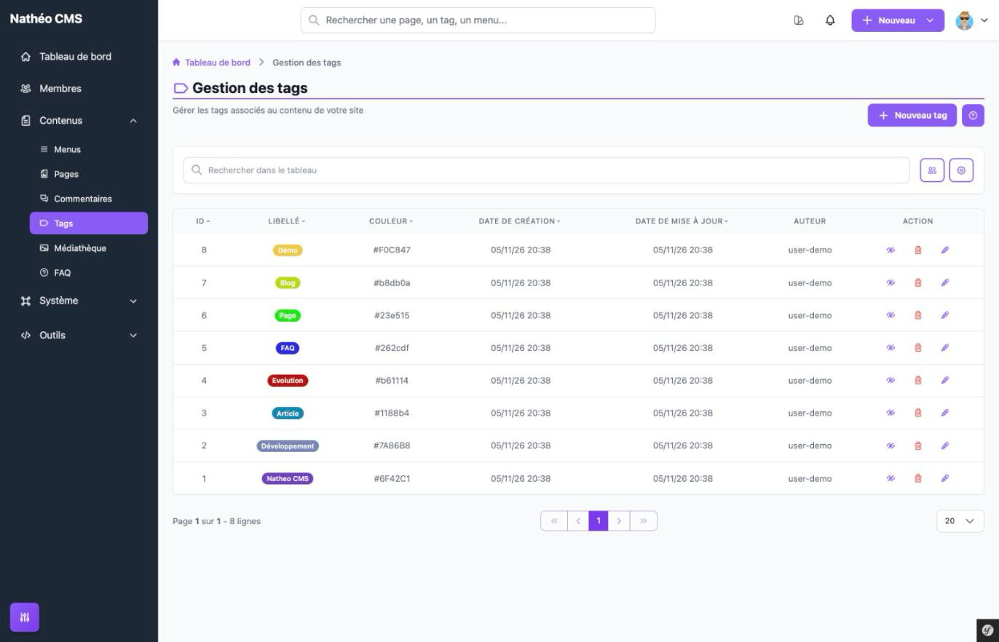

Les tags vous permettent de classer et de regrouper les pages de votre site.
Une fois créés, ils peuvent aussi servir de filtre pour vos visiteurs.

Cette page est accessible aux contributeurs, administrateurs et super-administrateurs,
à l'URL `/admin/{locale}/tag/`.

Le tableau liste tous les tags existants, avec leur couleur, leur auteur et leurs
dates de création et de mise à jour. Vous pouvez trier chaque colonne en cliquant
sur son en-tête, retrouver rapidement un tag grâce à la barre de recherche, et
filtrer sur **Moi / Tous** pour n'afficher que les tags dont vous êtes l'auteur.

Pour chaque tag, trois actions sont disponibles directement depuis la ligne :

- ✏️ **Modifier** — ouvre le tag pour changer sa couleur ou son libellé
- 👁️ **Activer / Désactiver** — un tag désactivé disparaît du site, mais rien
  n'est supprimé : vous pouvez le réactiver à tout moment
- 🗑️ **Supprimer** — retire définitivement le tag. Elle est refusée si le tag
  est encore utilisé par au moins une page : le message indique le nombre de
  pages concernées. Corrigez plutôt son libellé, ou retirez-le d'abord des pages

Un **Contributeur** ne dispose de ces actions que sur ses propres tags ; un tag
sans auteur n'est géré que par un administrateur (voir
[les droits sur les contenus](../../Systeme/roles.md#les-droits-sur-les-contenus)).

Et en haut de page, le bouton **Nouveau tag** ouvre le formulaire de création.

## Voir aussi
- [Créer ou modifier un tag](ajouter_editer.md)
- [Référence technique](technique.md) *(tables, services, routes)*
