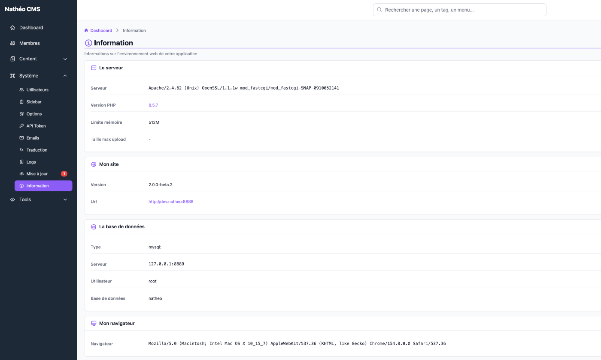

La page **Information** résume l'environnement technique sur lequel tourne le CMS : le serveur web et PHP, la version
de Nathéo, la base de données utilisée et le navigateur de la personne connectée. Elle sert surtout à vérifier une
installation, ou à donner ces informations quand on signale un problème.

La page est en **lecture seule** : rien n'y est modifiable.

## Accès

Réservée aux **super-administrateurs** (`ROLE_SUPER_ADMIN`), via *Système > Information* ou directement à l'URL
`/admin/{locale}/info/`.

## Contenu de la page

La page est découpée en quatre cartes.

### Le serveur

| Ligne | Contenu |
|---|---|
| **Serveur** | Logiciel du serveur web, tel qu'il se présente (par exemple `Apache/2.4.62 (Unix) OpenSSL/1.1.1w`) |
| **Version PHP** | Version de PHP. Elle est cliquable : le lien ouvre la page [phpinfo](#page-phpinfo) dans un nouvel onglet |
| **Limite mémoire** | Valeur de `memory_limit` dans la configuration PHP (par exemple `512M`) |
| **Taille max upload** | Censée afficher `upload_max_filesize`. N'affiche en pratique qu'un tiret (voir [Points d'attention](#points-dattention)) |

### Mon site

| Ligne | Contenu |
|---|---|
| **Version** | Version de Nathéo CMS installée (par exemple `2.0.0-beta.2`) |
| **Url** | Adresse à laquelle l'administration est consultée (protocole + nom de domaine + port), cliquable |

L'URL affichée est celle de la requête en cours, pas l'option **URL du site** des
[options système](options.md#site-web) : les deux peuvent différer si le site public et l'administration ne sont pas
sur la même adresse.

### La base de données

Les informations sont extraites de la variable d'environnement `DATABASE_URL` (fichier `.env.local`, voir
[Configuration de l'installation](../../Demarrage/configuration_installation.md)).

| Ligne | Contenu |
|---|---|
| **Type** | Moteur de base de données, suivi d'un deux-points (`mysql:`, `postgresql:`) |
| **Serveur** | Hôte et port de la base (par exemple `127.0.0.1:3306`) |
| **Utilisateur** | Utilisateur de connexion à la base. Le mot de passe n'est jamais affiché |
| **Base de données** | Nom de la base |

### Mon navigateur

Une seule ligne, **Navigateur**, qui affiche l'identifiant complet (*user agent*) du navigateur utilisé pour consulter
la page.

## Page phpinfo

Le lien de la **Version PHP** ouvre `/admin/{locale}/info/phpinfo` dans un nouvel onglet. C'est la page standard
`phpinfo()` de PHP, affichée brute (sans l'habillage de l'administration) : configuration complète de PHP, extensions
chargées, variables du serveur et **variables d'environnement**.

> ⚠️ Les variables d'environnement contiennent des secrets, notamment `DATABASE_URL` (avec le mot de passe de la base)
> et `APP_SECRET`. La page est réservée aux super-administrateurs, mais évitez de la partager ou de faire une capture
> d'écran de cette partie.

## Points d'attention

- **« Taille max upload » est toujours vide** : le paramètre PHP est lu avec un nom erroné (espace en trop), la
  valeur n'est donc jamais trouvée et seul le tiret qui suit s'affiche. Pour connaître la vraie valeur, chercher
  `upload_max_filesize` dans la page [phpinfo](#page-phpinfo).
- **Le type de base garde le deux-points** du format d'URL (`mysql:` au lieu de `mysql`).
- **L'analyse de `DATABASE_URL` suppose un format précis**, `moteur://utilisateur:motdepasse@hôte:port/base`.
  D'autres formats donnent un affichage faux, voire une erreur :
  - sans mot de passe ni port (`mysql://root@localhost/natheo`), l'utilisateur affiché devient `root@localhost`, et le
    serveur et le nom de la base restent vides ;
  - si le mot de passe contient un `@`, la partie après ce `@` est affichée comme nom de serveur.
- **L'URL du site dépend du serveur web** : elle est construite à partir de la variable `REQUEST_SCHEME`, que le
  serveur web doit transmettre à PHP. Derrière un proxy qui gère le HTTPS, elle peut afficher `http://` alors que le
  site est en `https://`.

## Notes techniques

| Élément | Emplacement |
|---|---|
| Contrôleur | `App\Controller\Admin\System\InfoController` (routes `admin_info_index` et `admin_info_phpinfo`) |
| Données | `App\Service\Admin\System\InformationService::getAllInformation()` |
| Templates | `templates/admin/system/info/index.html.twig` et `phpinfo.html.twig` (fonction Twig `getPhpInfo()` de `App\Twig\Extension\Admin\DevExtension`) |
| Version du CMS | Paramètre `app.version` de `config/services.yaml` |
| Traductions | Domaine `info` (`translations/info+intl-icu.*.yaml`) |

Les valeurs sont lues à chaque affichage, directement depuis PHP et les variables `$_SERVER` : rien n'est stocké
en base.

## Voir aussi
- [Pré-requis](../../Demarrage/pre_requis.md)
- [Options système](options.md)
- [Gestion des logs](logs.md)
