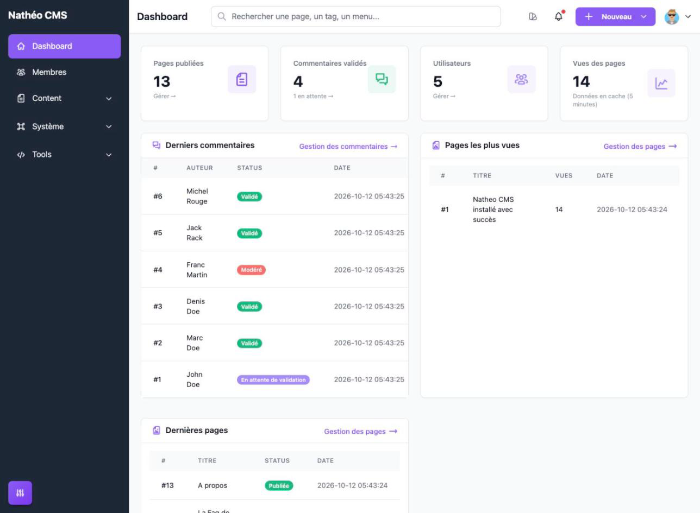
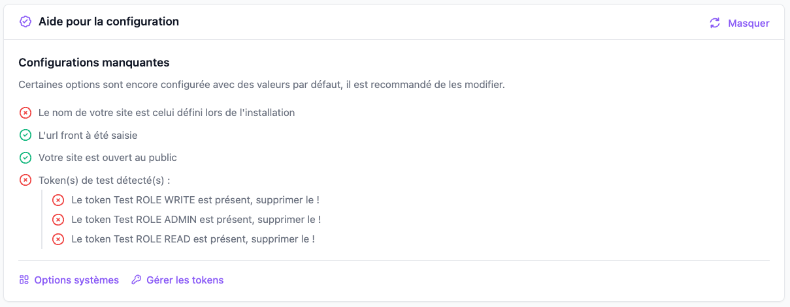
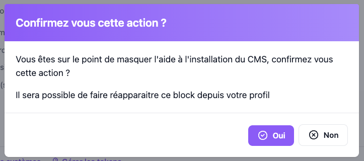
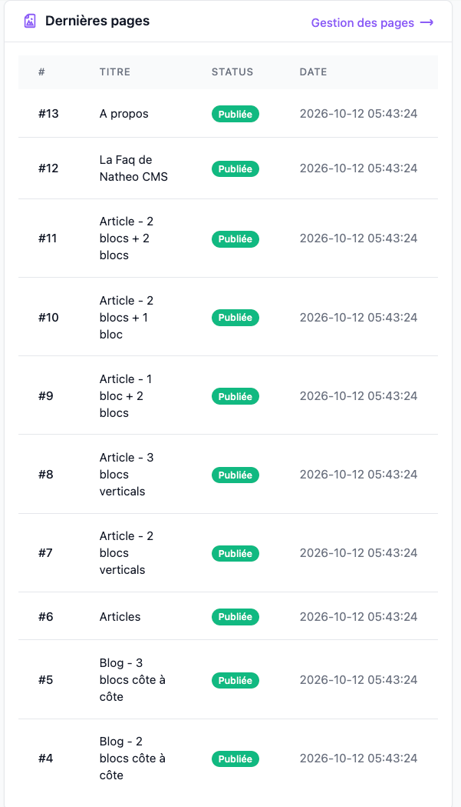

Le **tableau de bord** (libellé *Dashboard* dans l'interface) est la page d'accueil de l'administration : c'est
l'écran affiché juste après la connexion, après une prise de contrôle d'un compte
([Se connecter en tant que](../Systeme/Utilisateurs/listing.md#se-connecter-en-tant-que-prise-de-contrôle)) et quand
on clique sur le lien d'administration depuis le site public.

Il donne une vue d'ensemble de l'activité du site : quelques chiffres clés, les derniers commentaires, les dernières
pages créées et les pages les plus vues. Lors de la première connexion, il affiche aussi une aide qui liste les
réglages encore à faire.

La page est en **lecture seule** : on ne peut rien y modifier directement, chaque bloc renvoie vers l'écran de gestion
correspondant.

## Accès

Accessible à **tous les utilisateurs connectés** (`ROLE_USER`), via *Dashboard* en haut de la sidebar ou directement
à l'URL `/admin/{locale}/dashboard/`. L'élément *Dashboard* de la sidebar est verrouillé : il ne peut pas être masqué
depuis la [gestion de la sidebar](../Systeme/sidebar.md).

Le contenu affiché dépend du rôle :

| Bloc | Visible pour |
|---|---|
| Chiffres clés | Contributeurs et au-dessus (`ROLE_CONTRIBUTEUR`) |
| Aide pour la configuration | Super-administrateurs (`ROLE_SUPER_ADMIN`) pour qui l'aide est activée (voir [plus bas](#aide-pour-la-configuration)) |
| Derniers commentaires, Pages les plus vues, Dernières pages | Contributeurs et au-dessus (`ROLE_CONTRIBUTEUR`) |

Un utilisateur de rôle `ROLE_USER` arrive donc sur un tableau de bord **vide**.

## Chiffres clés

Quatre cartes résument l'état du site. Elles se chargent après l'affichage de la page (un squelette animé est visible
pendant le chargement).

| Carte | Valeur affichée | Lien |
|---|---|---|
| **Pages publiées** | Nombre de pages au statut *Publiée* (brouillons et archives exclus) | **Gérer** → [liste des pages](../Contenu/Pages/listing.md) |
| **Commentaires validés** | Nombre de commentaires au statut *Validé*. En dessous : le nombre de commentaires *En attente de validation* | **N en attente** → [liste des commentaires](../Contenu/Commentaires/listing.md) |
| **Utilisateurs** | Nombre total de comptes, quel que soit leur état (désactivés et anonymisés compris) | **Gérer** → [liste des utilisateurs](../Systeme/Utilisateurs/listing.md), affiché uniquement pour les super-administrateurs (seuls à avoir accès à cette liste) |
| **Vues des pages** | Nombre total de vues : somme des compteurs de lecture de toutes les pages. Au-delà de 1 000, la valeur est abrégée (`1.2K`, `3M`, `1B`) | Aucun |

Ces chiffres sont **mis en cache pendant 5 minutes** (mention *Données en cache (5 minutes)* sous la dernière carte) :
une page publiée ou un commentaire validé n'apparaît pas tout de suite dans les compteurs. Le cache est le même pour
tous les utilisateurs.

## Aide pour la configuration

Ce bloc liste les réglages importants qui ont encore leur valeur d'installation. Il est réservé aux
**super-administrateurs**. Il est **activé automatiquement pour le compte créé lors de l'installation** du CMS et
désactivé pour les autres comptes. On peut le réactiver ensuite avec le bouton **Afficher l'aide de configuration**
du [profil](../MonCompte/profil.md#autres-options).

Quatre points sont vérifiés à chaque chargement du bloc. Chacun s'affiche en vert (✓) s'il est réglé, en rouge (✗)
sinon :

| Point vérifié | En rouge si… | Où le corriger |
|---|---|---|
| Nom du site | L'option **Nom de votre site** vaut toujours `Nathéo CMS` | [Options système](../Systeme/options.md#site-web) |
| URL du front | L'option **URL du site** vaut toujours `http://www.value-must-be-change.com` | [Options système](../Systeme/options.md#site-web) |
| Ouverture du site | L'option **Ouvrir le site au public ?** est à *Non* | [Options système](../Systeme/options.md#site-web) |
| Jetons API | Un ou plusieurs **jetons de test** (*Test ROLE READ*, *Test ROLE WRITE*, *Test ROLE ADMIN*) sont présents : chacun est listé avec l'invitation à le supprimer. Ou bien aucun jeton n'existe | [Jetons API](../Systeme/ApiToken/jetons_api.md) |

Les liens **Options systèmes** et **Gérer les tokens**, toujours affichés en bas du bloc, mènent aux deux écrans
concernés.

| Bouton | Effet |
|---|---|
| ↻ (icône de rechargement) | Relance la vérification sans recharger la page, par exemple après avoir corrigé une option dans un autre onglet |
| **Masquer** | Désactive l'aide pour l'utilisateur connecté. Si des points sont encore en rouge, une confirmation est demandée (voir ci-dessous) ; si tout est vert, l'aide est masquée directement |

Une fois l'action confirmée, le message *Block masqué avec succès* s'affiche, puis le bloc disparaît au bout de
3 secondes. Le réglage est enregistré pour le compte : le bloc ne revient pas aux connexions suivantes, tant qu'il
n'est pas réactivé depuis le profil.

## Derniers commentaires

Les **10 derniers commentaires** reçus, du plus récent au plus ancien, toutes pages et tous statuts confondus.

| Colonne | Contenu |
|---|---|
| **#** | Identifiant du commentaire |
| **Auteur** | Nom saisi par l'auteur du commentaire |
| **Status** | Statut de modération : *Validé*, *En attente de validation* ou *Modéré* (*Inconnu* pour un statut non reconnu) |
| **Date** | Date et heure de création (`AAAA-MM-JJ HH:MM:SS`) |

Le lien **Gestion des commentaires** ouvre la [liste des commentaires](../Contenu/Commentaires/listing.md), où on peut
les modérer. Les lignes du tableau ne sont pas cliquables.

## Pages les plus vues

Les **10 pages qui ont le plus de vues**, de la plus vue à la moins vue. Seules les pages **publiées** ayant **au
moins une vue** sont listées : le bloc peut donc contenir moins de 10 lignes, voire aucune sur un site neuf.

| Colonne | Contenu |
|---|---|
| **#** | Identifiant de la page |
| **Titre** | Titre de la page dans la langue de l'interface (vide si la page n'est pas traduite dans cette langue) |
| **Vues** | Nombre de vues de la page |
| **Date** | Date de **création** de la page (pas celle de la dernière vue) |

Le lien **Gestion des pages** ouvre la [liste des pages](../Contenu/Pages/listing.md).

## Dernières pages

Les **10 dernières pages créées**, de la plus récente à la plus ancienne, quel que soit leur statut.

| Colonne | Contenu |
|---|---|
| **#** | Identifiant de la page |
| **Titre** | Titre de la page dans la langue de l'interface (vide si la page n'est pas traduite dans cette langue) |
| **Status** | *Publiée*, *Brouillon* ou *Archivée* (*Inconnu* pour un statut non reconnu) |
| **Date** | Date et heure de création |

Le lien **Gestion des pages** ouvre la [liste des pages](../Contenu/Pages/listing.md).

## Points d'attention

- **Les vues ne comptent que les lectures via l'API** : le compteur d'une page augmente quand le front la
  récupère avec `/page/find`, et seulement si elle est publiée (voir [API](../../API/References/find_page.md)).
- **Entre deux pages qui ont le même nombre de vues**, l'ordre dans « Pages les plus vues » n'est pas défini.
- **Les chiffres clés sont communs à tous** : un contributeur voit lui aussi le nombre total de comptes utilisateurs,
  même s'il n'a pas accès à leur liste.

## Notes techniques

| Élément | Emplacement |
|---|---|
| Contrôleur | `App\Controller\Admin\DashboardController` (routes `admin_dashboard_index`, `admin_dashboard_load_block`, `admin_dashboard_load_dashboard_stat`) |
| Blocs | `App\Service\Admin\DashboardService`, identifiants dans l'enum `App\Enum\Admin\DashboardBlock` (`help_first_connexion`, `last_comment`, `last_page`, `pages_most_viewed`) |
| Chiffres clés | `App\Service\Admin\StatisticsService::getDashboardStatistics()`, clé de cache `dashboard_statistics` (TTL 300 s) |
| Composants Vue | `assets/vue/controllers/Admin/Dashboard/Dashboard.vue` et `DashboardStatistics.vue`, blocs dans `assets/vue/Components/Dashboard/` |
| Traductions | Domaine `dashboard` (`translations/dashboard+intl-icu.*.yaml`) |
| Aide | Donnée utilisateur `KEY_HELP_FIRST_CONNEXION` (`1` = affichée), posée à `1` par l'installation et modifiée via la route `admin_user_update_user_data` |

Chaque bloc est chargé séparément en AJAX, après l'affichage de la page : un bloc lent ou en erreur ne bloque pas
les autres. Un identifiant de bloc inconnu renvoie le message *Une erreur est survenue lors du chargement du block*.
Les droits sont aussi contrôlés côté serveur : `DashboardBlock::getRole()` donne le rôle minimum de chaque bloc
(`ROLE_SUPER_ADMIN` pour l'aide, `ROLE_CONTRIBUTEUR` pour les autres) et la route des chiffres clés exige
`ROLE_CONTRIBUTEUR`. Un appel sans le rôle requis reçoit une erreur 403.

Le même contrôleur contient une page de démonstration réservée aux super-administrateurs (`admin_dashboard_page_demo`).
Elle sert d'exemple de [surcharge de contrôleur](../../Architecture/surcharge_controllers.md) : `config/cms/overwrite.yaml`
la redirige vers `admin_overwrite_page_demo`, accessible dans la sidebar via *Tools > Exemple Surcharge*.

## Voir aussi
- [Profil](../MonCompte/profil.md) : réactiver l'aide pour la configuration
- [Options système](../Systeme/options.md)
- [Jetons API](../Systeme/ApiToken/jetons_api.md)
- [Les rôles](../Systeme/roles.md)
